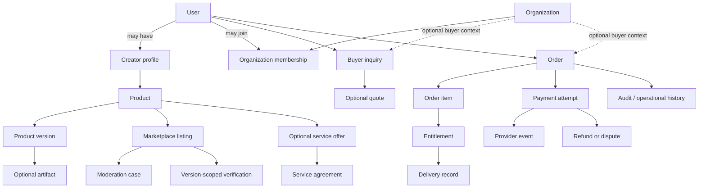

# Maketrail conceptual domain model

**Status:** Proposed business model — validate against real workflows before schema design  
**Version:** 0.1  
**Last updated:** 2026-11-24

## 1. Modeling rules

This document names business concepts and relationships. It is not a physical database schema.

- Model business meaning and lifecycle before tables.
- Separate a creator, product, listing, and product version.
- Separate a product license from an implementation service agreement.
- Separate a buyer identity from the optional organization on whose behalf they act.
- Separate an order from payment attempts, provider events, refunds, and entitlements.
- Keep platform-wide records distinct from personal, creator, and organization-owned records.
- Preserve historical facts that explain what a buyer accepted and what the platform did.

## 2. Main concepts

### Identity and participation
- **User:** an individual human account.
- **User credential/session:** authentication material and active sessions; never treat it as the user's business role.
- **Creator profile:** public creator identity, linked to an individual user or a studio/organization when that model is validated.
- **Organization:** optional business workspace, not required for marketplace participation.
- **Organization membership:** user-to-organization relationship with status and scoped role.
- **Platform role:** permission to perform an operator function; distinct from organization membership.

### Product and catalog
- **Product:** the enduring commercial/software offering.
- **Product version:** a specific release of that product with immutable version-specific technical and artifact metadata.
- **Listing:** the marketplace presentation of a product, including publication state, description, price/quote model, and discoverability fields.
- **Category/taxonomy term:** platform-managed classification.
- **License offer:** rights and terms offered for a product/version or purchase; exact model requires legal/product review.
- **Compatibility claim:** creator-declared supported environments, distinct from test evidence.
- **Artifact:** optional downloadable file or external delivery reference for a specific product version.
- **Documentation/demo reference:** external or hosted supporting material.

### Trust and operations
- **Rights declaration:** creator assertion about ownership or distribution authority.
- **Evidence record:** reference to material reviewed, reviewer, time, scope, and outcome.
- **Verification record:** bounded result for a particular version, checks, environment, date, and limitations.
- **Moderation case:** review workflow for listing, rights, abuse, report, or takedown.
- **Audit event:** attributable record of a sensitive action or material state change.
- **Support case:** operational record tied to a buyer, creator, listing, or order.

### Buyer engagement and commerce
- **Inquiry:** buyer question or qualified request related to a product; may be personal or organization-contextual.
- **Quote:** proposed commercial terms for a product or service where price is not fixed.
- **Order:** commercial purchase record with buyer context, seller/creator, line items, currency, accepted terms, and lifecycle.
- **Order item:** purchased product license or other separately identifiable item.
- **Payment attempt:** an attempt to collect funds through a provider.
- **Provider event:** authenticated external event with deduplication identity and processing outcome.
- **Refund/dispute:** adjustment or external challenge associated with a payment/order.
- **Fee calculation:** reproducible marketplace fee calculation under a recorded policy version.
- **Ledger entry:** auditable financial movement/obligation record; exact accounting model requires professional review.
- **Entitlement:** permission granted to a buyer for a defined product/version/rights scope.
- **Delivery record:** delivery instruction, download grant, or fulfillment event.
- **Service offer:** creator/partner offer to implement or maintain a product.
- **Service agreement:** separate scope, provider, price, deliverables, acceptance and support terms.

## 3. Relationship overview

The diagram is conceptual. Not every relationship is one-to-one, and exact cardinality depends on the final license and commerce model.

## 4. Ownership and access classification

| Data class | Examples | Access principle |
|---|---|---|
| Public marketplace | Published listings, public creator profiles, categories | Public read; only approved publishing workflow can change |
| User-private | Credentials, sessions, private profile settings | User and narrowly authorized operations |
| Creator-controlled | Draft listings, product versions, rights declarations | Creator owner/collaborators and authorized reviewers |
| Organization-scoped (optional) | Membership, shared inquiry, team collection, organization order context | Active membership plus resource-specific permission |
| Transaction-private | Orders, accepted terms, payment references, entitlements | Buyer, relevant seller/creator as needed, restricted operations |
| Platform-restricted | Moderation evidence, fraud signals, audit, policy configuration | Explicit operator permission and audit |
| External-provider data | Provider customer/account/event references | Minimum necessary references; provider remains authoritative for its own state |

A resource can involve multiple parties without being owned by all of them. For example, a creator may respond to one buyer inquiry without gaining access to the buyer's entire account or organization.

## 5. Lifecycle boundaries

### Product and listing
Product concept → product version/draft → listing submitted → review → changes requested / approved / rejected → published → suspended / archived.

A product can have multiple versions. A new version does not silently rewrite the version or license facts attached to an earlier purchase.

### Inquiry
Created → delivered to authorized creator → responded / needs clarification → quoted (optional) → converted to order / closed / expired.

### Order and payment
Order draft or pending → payment pending → confirmed / failed / cancelled → fulfilled (where applicable) → refunded / disputed / partially adjusted as policy allows.

Do not collapse payment state and order state into one status field. A payment provider event may arrive late, duplicate, or out of order.

### Entitlement and delivery
Not granted → active after required verified conditions → suspended/revoked/expired according to policy. Keep delivery attempts and access events separately traceable.

### Service engagement
Requested → scoped → proposed → accepted → in progress → delivered → accepted / disputed / cancelled. This is not the same lifecycle as a product download or license purchase.

## 6. Invariants to preserve

1. Only approved and published listings are public.
2. Every published product listing resolves to an identifiable product and version policy.
3. Creator-declared claims are not represented as independent verification.
4. Rights and verification evidence are scoped, attributable, and time/version aware.
5. Accepted license and commercial terms are snapshotted for each order item.
6. Browser redirects never establish payment success.
7. Provider events are authenticated, deduplicated, and processed idempotently.
8. Entitlements are granted only by server-side policy after the required order/payment state.
9. A refund or dispute triggers an explicit entitlement policy, not an accidental status side effect.
10. Product license and service agreement remain separate legal/commercial concepts.
11. Organization membership is checked for organization-scoped resources; it does not grant access to all marketplace data.
12. Sensitive operator actions are attributable and auditable.

## 7. Questions before physical schema design

- Can a product have multiple commercial license offers?
- Does each purchase license a product generally or a specific version?
- Can one order contain multiple creators/sellers, or must checkout be single-seller initially?
- Are products sold at fixed price, quote, free, or all three?
- Is the creator always the seller/contracting party?
- Is an organization required for business invoices or merely recorded as buyer context?
- Which records are legally required to be retained, exported, or deleted?
- What delivery modes will the first release actually support?
- What constitutes a verified purchase for reviews and support?

Resolve these from product, legal, and provider requirements before migrations are designed.

## 8. Related documents

- [Architecture strategy](architecture-strategy.md)
- [Tenancy model](tenancy-model.md)
- [Transaction lifecycle](../product/transaction-lifecycle.md)
- [Business model](../strategy/business-model.md)
- [Threat model](threat-model.md)
