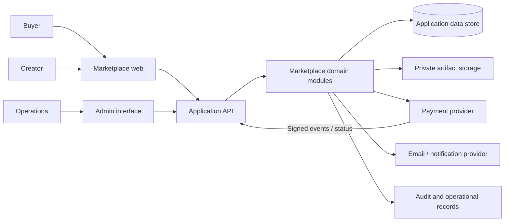

# Maketrail system design

**Status:** Proposed logical design — discovery required; not an implementation specification  
**Version:** 0.1  
**Last updated:** 2026-11-24

## 1. Purpose and guardrails

This document describes a plausible system shape for a marketplace that helps buyers discover, evaluate, purchase, and integrate creator-built software solutions.

It is a design hypothesis. It does not select a framework, cloud provider, database, payment provider, or hosting vendor. The first release must be narrowed after market validation, legal/payment review, and selection of a specific end-to-end buyer problem.

Architecture should optimize for:
- A trustworthy buyer-to-creator transaction.
- Clear ownership, licensing, version, delivery, and support records.
- Strong separation between public catalog data, private account data, and financial/operational data.
- Safe handling of untrusted creator submissions and downloadable artifacts.
- Auditable operations and recoverable asynchronous workflows.
- Low operational complexity while demand and transaction volume are unknown.

## 2. Proposed high-level shape

Evaluate a **modular application with clearly separated interfaces and domain modules** as the initial architecture hypothesis. A modular monolith may be simpler to operate than independently deployed microservices at an early stage, but this remains a proposal to test against team capability, expected workload, isolation requirements, and deployment constraints.

Logical clients:
- **Marketplace web:** public discovery, product detail, creator-facing publishing, and buyer account experiences as validated.
- **Admin interface:** restricted listing review, creator/account support, reports, refunds/disputes, and audit views.
- **Mobile client:** not assumed for the initial release; validate whether native mobile workflows add meaningful value over responsive web.

Logical server capabilities:
- Identity and authorization.
- Creator profiles and product catalog.
- Listing submission, moderation, and publication.
- Orders, licenses, entitlements, and delivery authorization.
- Payment-provider integration and financial ledger.
- Notifications and communication.
- Reporting and operational audit.

These are logical boundaries, not a requirement for separate deployables. Modules should own their business rules and data access even if they initially share a process or database.

## 3. System context

External systems are trust boundaries. Provider responses must be authenticated and validated; browser redirects and client-side state are never authoritative for payment or entitlement decisions.

## 4. Application boundaries

### Marketplace web

Responsibilities:
- Render public catalog and product pages.
- Support search, filters, and product evaluation.
- Provide authenticated buyer and creator workflows that are included in the validated MVP.
- Collect user intent and display server-confirmed transaction state.

Must not:
- Decide whether a payment succeeded.
- Grant entitlements based on client-side redirects.
- Expose private artifact storage credentials or unrestricted object paths.
- Treat creator-declared compatibility or verification as independently tested facts.

### Admin interface

Responsibilities:
- Provide a separate, tightly controlled operations experience.
- Support review queues, rights/ownership evidence, reports, takedowns, support, and appropriate transaction operations.
- Require elevated authentication and explicit permissions for sensitive actions.
- Display audit history and the evidence behind verification labels.

Admin APIs must enforce authorization on the server. Hiding a control in the interface is not access control.

### Application API and domain modules

Proposed module ownership:

| Module | Owns | Key invariants |
|---|---|---|
| Identity and access | Accounts, sessions, roles, permissions | Deny by default; enforce resource ownership and role boundaries |
| Creator and catalog | Creator profiles, products, versions, listing metadata | Only approved listings are public |
| Moderation and trust | Review cases, evidence, verification records, reports | Verification is scoped to a version and recorded evidence |
| Commerce | Orders, accepted license terms, fee calculation records | Immutable order facts and reproducible fee rules |
| Payment integration | Provider references, payment/refund event processing | Provider-verified state; idempotent event handling |
| Entitlements and delivery | Access grants and delivery authorization | Access follows order, license, and refund/dispute policy |
| Notifications | Notification intents and delivery outcomes | Retry-safe; no secrets or unnecessary sensitive data |
| Operations and audit | Administrative actions and case history | Sensitive actions are attributable and reviewable |

A module may be implemented as a package, service layer, or separate deployable later. Avoid cross-module writes that bypass the owning module's rules.

## 5. Data ownership and conceptual entities

Likely entities include:
- User, session, role, permission, organization (if validated).
- Creator profile and creator eligibility/review status.
- Product, product version, listing, category, technology metadata.
- Ownership declaration, license, dependency disclosure, verification record.
- Moderation case, report, takedown request, review.
- Order, order item, accepted terms snapshot, payment attempt, provider event.
- Fee calculation, ledger entry, refund, dispute, payout reference.
- Entitlement, artifact metadata, delivery event.
- Service offer, quote, service agreement, milestone/deliverable (if services enter MVP).
- Notification, audit event, support case.

Important modeling principles:
1. Separate a product from its versions and public listing state.
2. Preserve the exact license and commercial terms accepted for an order; do not silently mutate historical terms.
3. Keep provider payment identifiers and internal order identifiers distinct.
4. Store money as integer minor units with an explicit currency and documented rounding rules; do not use floating-point arithmetic for financial amounts.
5. Make financial entries append-only or otherwise fully auditable. Corrections should be explicit adjustments, not silent edits.
6. Keep creator-declared metadata distinct from independently observed verification evidence.
7. Store only personal data needed for a defined purpose and retention period.
8. Define data retention, deletion, export, and legal-hold behavior before launch.

The final schema depends on the first validated product type, transaction model, and jurisdiction.

## 6. Core data and transaction flows

### Product publishing

1. Creator creates a draft and supplies structured product, version, license, support, compatibility, and ownership information.
2. Submission creates a review case.
3. Operations checks rights, listing policy, and required evidence.
4. A decision and reviewer record are stored.
5. Only approved and published listings are exposed in the public catalog.
6. Material changes (new version, license, ownership, delivery method) trigger the appropriate re-review or buyer notification policy.

### Purchase and entitlement

1. Buyer reviews the product, license, seller/provider identity, price, tax/fee presentation, delivery, and refund/support terms.
2. Server creates a pending order and a checkout request with the selected payment provider.
3. Provider processes payment.
4. Server validates a signed provider event or retrieves authoritative provider status.
5. An idempotent handler records the event and updates the order/payment state.
6. Entitlement is created only after the required confirmed state and policy checks.
7. Delivery service authorizes access after checking the buyer, order, entitlement, license, and current restriction/refund state.
8. Reconciliation compares internal records with provider records.

The client success URL is a user-experience signal only. It cannot prove payment or grant access.

### Refund and dispute

- Record the provider event/reference, amount, currency, reason, actor, and timestamps.
- Apply idempotency and prevent duplicate provider refund calls.
- Re-evaluate entitlement according to the product license, refund policy, and legal advice.
- Preserve a complete audit trail for adjustments and manual interventions.
- Route chargebacks, IP claims, and fraud signals to authorized operations staff.

### Implementation services

If services are included, model the product license and service agreement separately. Scope, provider, deliverables, acceptance criteria, payment arrangement, and dispute conditions must be explicit. Do not design Maketrail as holding milestone funds unless provider capability and legal structure explicitly permit it.

## 7. Product artifact storage and delivery

Creator uploads and downloadable packages are untrusted input.

Proposed controls:
- Keep uploaded artifacts in private object storage, separate from public application assets.
- Use generated object identifiers; do not trust user-provided paths or filenames.
- Enforce file size, type, count, and quota limits.
- Validate file signatures rather than relying only on extension or browser MIME type.
- Quarantine uploads until policy checks and configured scanning complete.
- Do not execute uploaded code or packages in the application runtime, developer workstation, or production environment.
- If dynamic analysis is ever justified, use a separately designed isolated environment with strict network, CPU, memory, time, filesystem, and credential restrictions.
- Issue short-lived, narrowly scoped download access only after server-side entitlement checks.
- Record artifact version, checksum, upload actor, scan/evaluation status, and delivery events.
- Define retention, deletion, malware response, and re-scan procedures.

For an early concierge pilot, creator-managed delivery may be safer and simpler than building a general artifact pipeline. Validate whether direct platform delivery is essential.

## 8. Payment-provider integration

Payment provider selection is an external dependency and a launch gate.

Evaluate providers against:
- Supported buyer and creator countries.
- Platform/marketplace business model eligibility.
- Merchant-of-record and contractual seller implications.
- Connected-account and payout availability.
- Platform fee support and fee transparency.
- Refund, dispute, chargeback, and reconciliation APIs.
- Tax, invoicing, currency, and settlement capabilities.
- Webhook signature verification, idempotency, event replay, and operational tooling.
- Fees, reserves, onboarding, prohibited-business rules, and support.

Design rules:
- Prefer hosted or tokenized payment collection; do not store raw card data.
- Keep provider-specific behavior behind an adapter boundary where this does not obscure important provider constraints.
- Verify signatures and retrieve authoritative status when needed.
- Persist provider event IDs and process events idempotently.
- Treat event delivery as asynchronous, delayed, duplicated, and potentially out of order.
- Reconcile provider records with the internal ledger.
- Never promise escrow, guaranteed payouts, or settlement timing without explicit provider and legal support.

No payment provider or merchant-of-record model is selected in this document.

## 9. Background jobs and notifications

Potential asynchronous work:
- Email and transactional notifications.
- Payment event processing and reconciliation.
- Artifact scanning and quarantine workflow.
- Listing review reminders and stale-case alerts.
- Entitlement expiry/revocation where applicable.
- Analytics aggregation and operational reports.

Requirements:
- Jobs must be retry-safe and idempotent where they cause side effects.
- Use bounded retries, backoff, dead-letter handling, and visible failure states.
- Keep durable source records; do not make a queue the only record of a financial or entitlement event.
- Avoid putting credentials, full payment data, or unnecessary personal information in job payloads.
- Provide operational visibility for stuck and repeatedly failing jobs.

The initial implementation may use a managed queue or database-backed job runner. Choose after workload and hosting constraints are known.

## 10. Search and discovery

Start with structured catalog fields and a small, validated taxonomy. Search infrastructure should be chosen based on:
- Catalog size and update frequency.
- Required typo tolerance, relevance, filters, and facets.
- Language and regional requirements.
- Index freshness and recovery behavior.
- Operational cost and ability to export/rebuild the index.

The authoritative product data remains in the primary data store; a search index is a derived, rebuildable projection. Avoid adding a dedicated search cluster before basic catalog needs justify it.

## 11. Deployment and environments

No vendor or topology is selected. Any future deployment design should provide:
- Separate development, preview/staging, and production environments.
- Isolated credentials and data; no production secrets in local or preview environments.
- Managed secret storage and rotation.
- Automated build, test, dependency, and deployment checks appropriate to risk.
- Database backup, restore testing, migration discipline, and recovery objectives.
- Centralized structured logs, metrics, traces, and alerting with sensitive-data redaction.
- Least-privilege deployment identities and restricted production access.
- Rollback or forward-fix procedures and documented incident ownership.

Prefer managed services when they reduce operational burden without creating unacceptable lock-in, compliance, or cost risk.

## 12. Architecture options to evaluate

| Decision area | Plausible options | Evaluation criteria |
|---|---|---|
| Application topology | Modular monolith; selected services; microservices | Team size, deployment independence, isolation, operational burden |
| Client delivery | Responsive web; separate admin app; native mobile later | Buyer/creator workflows, accessibility, operating cost |
| Primary data store | Relational database; other models only for proven needs | Transaction integrity, querying, operations, backup, expertise |
| Artifact storage | Managed object storage; creator-managed delivery for pilot | Security, cost, download control, regional availability |
| Search | Database search; managed search service | Catalog size, relevance, facets, freshness, cost |
| Background work | Managed queue/worker; database-backed jobs | Reliability, throughput, retry semantics, operations |
| Authentication | Managed identity provider; application-managed identity | Region support, security, account recovery, integration, cost |
| Payments | Marketplace-capable provider; compliant direct invoicing pilot | Country coverage, legal roles, fees, payouts, refunds |
| Hosting | Managed application platform; cloud primitives | Team capability, security controls, portability, cost |

## 13. Decisions deliberately deferred

- Programming languages, frameworks, and frontend/backend repository structure.
- Database vendor, schema migrations, and tenancy model.
- Cloud provider, regions, network topology, and deployment platform.
- Identity provider and session strategy.
- Payment provider, merchant-of-record, seller model, tax, and payout flow.
- Search engine and analytics vendor.
- Artifact scanning vendor and isolated execution design.
- Mobile application scope.
- Multi-region, high-availability, and scale targets.

These decisions should be made only when the validated MVP and operational requirements make the trade-offs concrete.

## 14. Next architecture work

Before implementation:
1. Validate the first buyer problem and product category.
2. Decide whether the pilot needs checkout and platform-managed delivery or can use compliant concierge arrangements.
3. Confirm launch countries, seller/merchant roles, and payment-provider eligibility with qualified advice.
4. Create a threat model for identity, uploads, admin operations, payments, and delivery.
5. Define MVP non-functional requirements and operational ownership.
6. Convert only approved capabilities into feature specifications and engineering tasks.

## 15. Related documents

- [Feature map](../features/feature-map.md)
- [Transaction lifecycle](../product/transaction-lifecycle.md)
- [Business model](../strategy/business-model.md)
- [Architecture decision log](../decisions/README.md)
